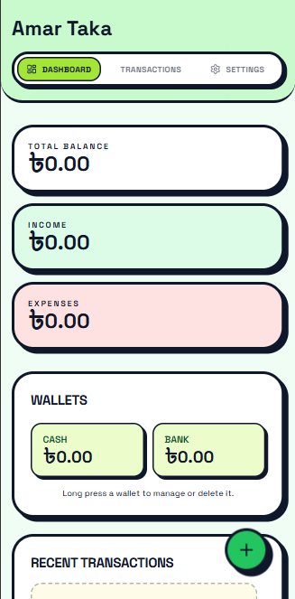
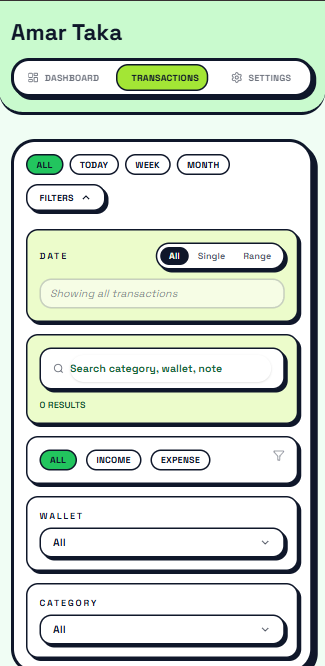
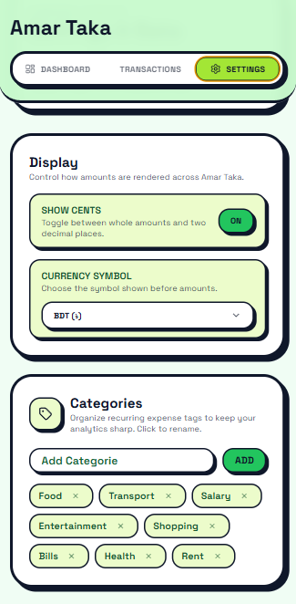

# Amar Taka 🪙

**Amar Taka** (*"My Money"*) is a simple, bold, and privacy-first personal finance tracker. It helps you keep track of your income, expenses, and wallet balances right from your browser—no logins, no ads, and no creepy tracking.

All your financial data stays **100% offline** on your device.

---

## ✨ Features at a Glance

- 🔒 **Private & Offline-First**: Your data is stored locally in your browser. What you spend is nobody else's business.
- ⚡ **Quick Time Filters**: Filter transactions by **Today**, **Week**, or **Month** with a single click.
- 👛 **Multiple Wallets**: Keep track of cash, bank accounts, and mobile wallets all in one place.
- 🏷️ **Custom Categories**: Group your expenses and income however you like.
- 📊 **Visual Insights**: Spot monthly spending trends and see where your money goes.
- 🔄 **Recurring Payments**: Easily manage recurring expenses and income.

---

## 📸 Screenshots

### 1. Main Dashboard
Get an overview of your total balance, income vs. expenses, wallet balances, and monthly spending insights.



### 2. Transactions & Smart Filters
Search through past payments or filter instantly by date range (Today, Week, Month), transaction type, wallet, or category.



### 3. Quick Add Transaction
Add income or expenses in seconds with a clean, popup form.


### 4. Settings & Customization
Manage your wallets, custom categories, show/hide cents, or reset demo data whenever you want a fresh start.



---

## 🚀 Quick Start

Want to run Amar Taka locally? It takes less than a minute!

### 1. Clone the repository
```bash
git clone https://github.com/your-username/AmarTaka.git
cd AmarTaka
```

### 2. Install dependencies
```bash
pnpm install
# or npm install / yarn install
```

### 3. Run the development server
```bash
pnpm dev
```

Open [http://localhost:3000](http://localhost:3000) in your browser and start tracking your money!

---

## 🛠️ Built With

- **Framework**: Next.js (App Router) & React
- **Styling**: Tailwind CSS & Lucide Icons
- **State**: Offline LocalStorage state
- **Language**: TypeScript

---

## 📄 License

Distributed under the MIT License. Feel free to use, modify, and share!
